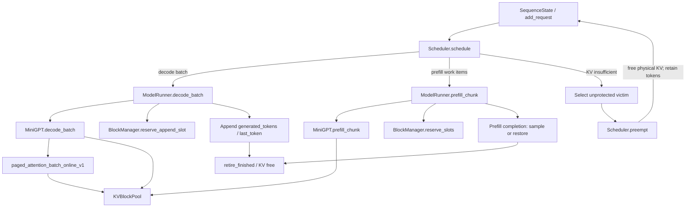

# Inference Runtime 架构与关键不变量


## 1. 控制流与数据流



`MiniRuntime.step()` 先调用 Scheduler 构造本轮计划，随后执行本轮 Decode，再按 `PrefillWorkItem` 执行 Prefill（在同一次 step 内）；收尾阶段根据已生成 Token 数判断终止并调用 `retire_finished()` 释放 Blocks。

`Scheduler.schedule()` 基于 `max_running`、`max_num_batched_tokens` 和剩余 KV Blocks 进行预算。当前代码的 Decode 优先于 Prefill；已进入本轮计划的请求会加入 `protected_ids`，避免在同一轮被当作 Victim 回收。

## 2. 请求状态语义

| 字段 | 当前含义 |
|---|---|
| `prompt_tokens` | 原始输入 Token（不可因 Recompute 而改变） |
| `generated_tokens` | 已经对外生成的所有输出 Token |
| `last_token` | 最后一个已生成但尚未送入下一次 Decode 的 Token |
| `length` | 已写入 KV Cache 的逻辑 Token 数；完成释放 / 抢占后归零 |
| `block_table` | 请求拥有的物理 KV Block ID 列表 |
| `prompt_pos` | 普通 Prefill 的 Prompt 进度；Recompute 期间暂用于历史前缀进度 |
| `recompute_tokens` | `None` 表示普通 Prefill；否则是需重建 KV 的历史 Token 前缀 |
| `max_tokens` | **Prompt + Output 的总 Token 预算**，不是 `max_new_tokens` |

完成条件为：

```python
len(seq.generated_tokens) >= seq.max_tokens - seq.prompt_length
```

正常 Prefill 的末尾会采样第一个输出 Token，因此在 RUNNING 状态下通常有：

```text
KV logical length = prompt length + generated count - 1
pending last_token = generated_tokens[-1]
```

此等式限定在完成正常 Prefill、未进入抢占重建的 RUNNING 状态下；在 Prefilling/Waiting/Finished 中不应不加区别地使用。

## 3. Paged KV / BlockManager

BlockManager 负责逻辑 Block 映射、物理 Block 所有权、空闲链表及 Block 数量预算。KVBlockPool 持有真正的 K/V Tensor。核心检查：

```text
free physical blocks ∩ allocated physical blocks = ∅
free blocks ∪ allocated blocks = [0, num_blocks)
每个活跃请求的 Block Table 无重复物理 Block
len(block_table) = ceil(length / block_size)  # 在完成执行与 commit 后
```

注意 `reserve_slots()` 会在执行模型计算前占用物理块，而 `length` 在模型计算成功后才更新；因此上面的长度等式不应作为 reserve/commit 之间的中间态断言。当前实现也没有为模型执行异常提供完整回滚事务。

## 4. Batched Decode

`ModelRunner._prepare_decode_batch()` 根据请求列表构造：

- `input_ids: [B, 1]`：每条请求待处理的 `last_token`；
- `positions: [B]`：各请求当前 `length`；
- `context_lengths: [B]`：包含本轮新 Token 的上下文长度；
- `block_tables: [B, M]`：用 `-1` 填充不同长度的 Block Table；
- `slot_mapping: [B]`：本轮新 KV 应写入的物理 Slot。

模型的 QKV/FFN 等计算使用批量 Tensor；Attention 调用 `paged_attention_batch_online_v1`。该实现使用批量 Tensor 运算与在线 Softmax，但仍有 Python 层 `for logical_block in range(M)`，不能称为单个融合 Triton/CUDA PagedAttention Kernel。

Batch Attention 已加入 score scaling、在线状态累积，以及对无效 Value Padding 的归零屏蔽，防止未写入 KV 中的 NaN 污染归约。

## 5. Recompute-based Preemption

当前实现提供两种 policy：

- `conservative`：准入前承诺请求未来最大 KV Blocks；在最大容量内避免发生重算抢占。
- `recompute`：只基于当前空闲物理 Block 准入；运行中缺空间时，选择未加入本轮计划的 Victim，保留输出历史、释放 KV，再按历史 Token 重新 Prefill。

正常 RUNNING Request 被抢占时，重计算前缀为：

```python
seq.recompute_tokens = seq.prompt_tokens + seq.generated_tokens[:-1]
```

`generated_tokens[-1]` 没有写入 KV，作为待处理 `last_token` 保留。执行完 Recompute Prefill 后，**不能再次采样**，只需清除 `recompute_tokens` 并转回 RUNNING。这保证生成进度不倒退。

若在普通 Prefill 尚未完成时被抢占，则丢弃部分缓存并重头 Prefill；若正在重建时再次被抢占，则保留重计算历史前缀并重新从头构建。

`protected_ids` 保护已调度但尚未执行的请求；发生抢占的轮次会暂停新增准入，减少 ping-pong 现象。**目前没有通用无饥饿证明，也没有生产级公平性策略。**
